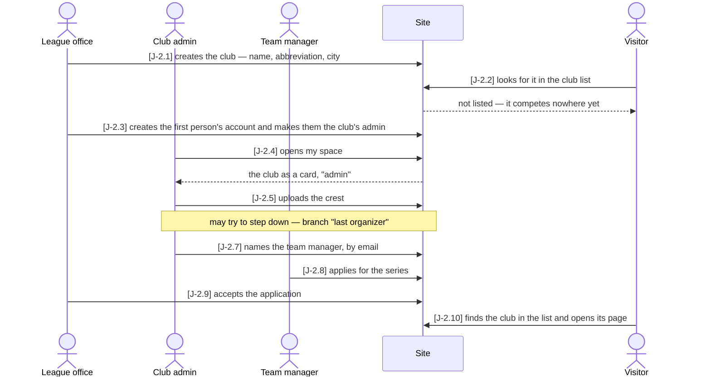
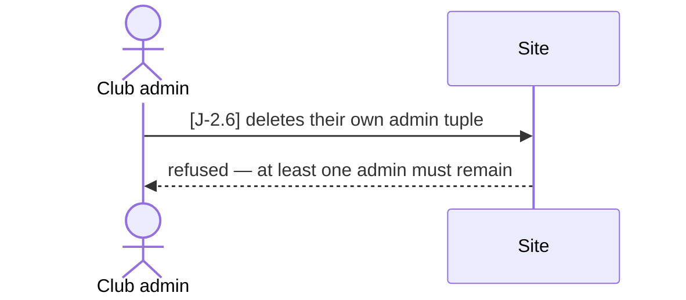

# J-2 ◐ A new club gets going and runs itself

As the **association** I want **a club to be set up once by the league office and then to
run itself** — its own admin, its crest, its organizers, its applications to compete — so
that **nobody at the league office maintains a club's people, and the club appears in
public exactly when it competes**.

Who: league office, club admin, team manager, visitor
Starting point: a running installation; the club does not exist. The person who will
organize the club's sailing has an account already (registered herself, Story Z-4 —
Journey J-3 shows that part). A published series of the current year exists.
Goal: the club has an admin and a manager of its own, a crest, and is a participant of a
series — and therefore listed publicly.

### Main path

### Branch "last organizer" — the only organizer tries to step down

After J-2.5; nothing changes, and the main path goes on at J-2.7.

| Step | Path | Story | Who | What is then true |
|---|---|---|---|---|
| J-2.1 | main | A-1 | league office | the club exists, its address made from the abbreviation |
| J-2.2 | main | A-7 | visitor | the club is not in the public club list — it competes nowhere yet |
| J-2.3 | main | A-8 | league office | the account exists (verified by administration) and holds `admin` on the club |
| J-2.4 | main | Z-8 | club admin | my space lists the club, with the relation `admin` |
| J-2.5 | main | V-3 | club admin | the crest is stored; the club's `logo_url` points at it |
| J-2.6 | last organizer | A-8 | club admin | refused with `last-organizer` (409); the club keeps its admin |
| J-2.7 | main | A-8 | club admin | the person holds `manager` on the club — no acceptance step |
| J-2.8 | main | V-5 | team manager | an application for the series, status `requested`; still not public |
| J-2.9 | main | A-9 | league office | accepted: the club is a participant of the series |
| J-2.10 | main | B-7 | visitor | the club is in the public list, and its page shows the series |

Retired steps: none

Open: V-11 ("manage our own club page" — description, contact) is ○ and so not a step.
(Drawing this journey found that a club's admin had no screen for the crest, J-2.5; since
2026-10-17 it is on the Members tab of the club's page in my space.)

Tests: `api/tests/stories/test_journey_club.py::TestANewClubRunsItself::test_from_nothing_to_a_public_club`
