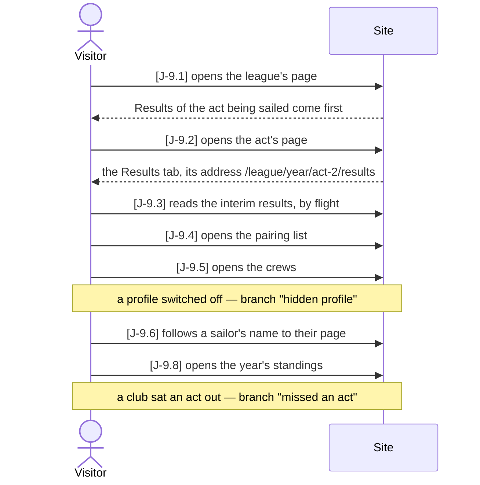
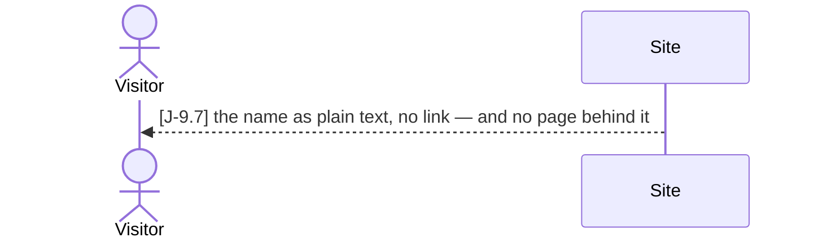
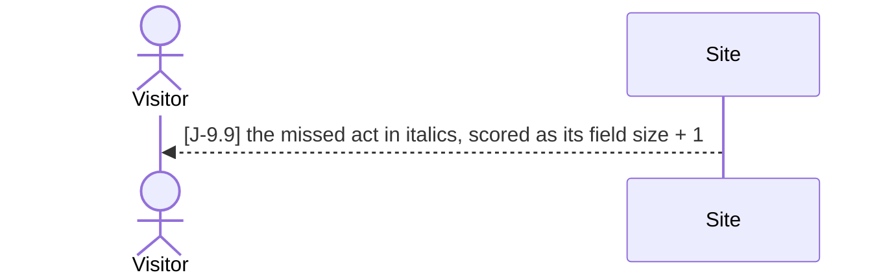

# J-9 ● A fan follows an act

As a **fan** I want **to get from the league's page to the act being sailed, see how it
stands, who is on which boat and who sails for each team, look up a sailor, and then see
what it does to the year's table** — so that **on a race day, on a phone, every question
is a tap away from the one before**.

Each page is its own story; what this journey holds together is that they are **one
season**: the act the league page offers is the act whose results, draw and crews the fan
reads, a name in a crew leads to that person's page, and the same act is a column of the
year's table.

Who: visitor
Starting point: a published league year with two acts — act 1 sailed to the end, act 2
under way with its first flight scored and one club's crew named; two of the series'
clubs sit act 2 out. The visitor is not signed in.
Goal: the visitor has read the running act and knows where every club stands in the year.

### Main path

### Branch "hidden profile" — the sailor switched their page off

After J-9.5, instead of J-9.6; the main path goes on at J-9.8.

### Branch "missed an act" — a club did not sail one of the acts

At J-9.8, in the same table; the journey ends there.

| Step | Path | Story | Who | What is then true |
|---|---|---|---|---|
| J-9.1 | main | B-14 | visitor | the league's current year is open; while an act is live its *Results* chapter opens the page and names the act |
| J-9.2 | main | B-15 | visitor | the act's page is open on *Results* — racing has begun — and every tab has its own address |
| J-9.3 | main | B-2 | visitor | the interim standing of the act: every entered team ranked, its points per flight sailed |
| J-9.4 | main | B-3 | visitor | the draw: every race with its boats by colour, each team once per flight; a club not entered has no seat |
| J-9.5 | main | B-12 | visitor | one card per entered team with its crew, helm first; a crew not named yet says so; names only |
| J-9.6 | main | B-8 | visitor | the sailor's page: the series registration and this act's lineup, no contact details |
| J-9.7 | hidden profile | S-4 | site | the name stays in the crew as plain text; the page answers 404 like nobody at all |
| J-9.8 | main | B-1 | visitor | the year's table: a column per act, the running act counted, each heading leading to its act |
| J-9.9 | missed an act | A-5 | site | the club that sat act 2 out carries its field size + 1 there, and the cell says so |

Retired steps: none

What this journey leaves to its own story: the live updates themselves (B-5 ◐) — the
results and the table refreshing without a reload while the race committee enters a
race. The live map (L-1) and the act's notice board (VA-11) are tabs on the same page,
not steps a fan has to take to follow the standing.

Open: a missed act's cell has no `data-testid` or attribute of its own — it is told by
its italics and tooltip only, so the browser walk cannot point at it, and the seed has no
club missing a 1. Liga act to point at anyway.

Tests: `api/tests/stories/test_journey_fan.py::TestAFanFollowsAnAct::test_from_the_league_page_to_the_standings`,
`e2e/journeys.spec.ts::J-9: a fan follows an act`
