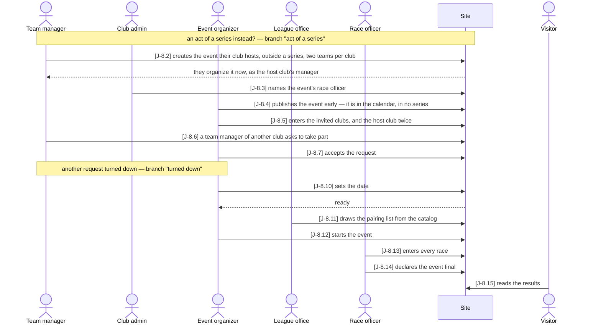
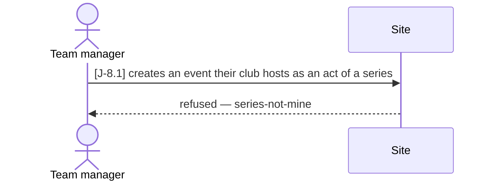
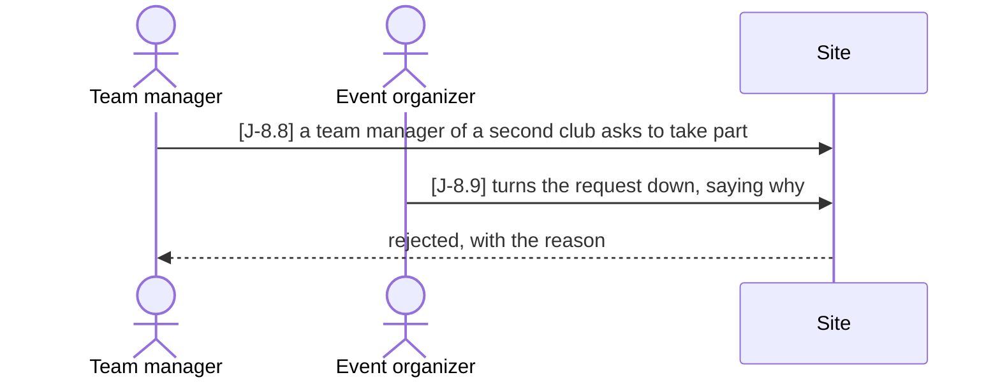

# J-8 ◐ A club hosts its own event

As the **association** I want **a club to run its own regatta here — a club cup, a
training weekend — outside any series, with its own people**, so that **the site is a
service to other clubs and not only the leagues' tool**. That is why an event need not
belong to a series, and why a club's organizers may create an event their own club hosts.

Who: team manager, club admin, event organizer, league office, race officer, visitor
Starting point: the clubs exist (Journey J-2); the host club has a team manager and a club
admin; no event exists; the race officer has an account and no relation yet.
Goal: a final, public event outside any series — its results show both of the host club's
teams and an applicant the host accepted, and it scores in no series table.

### Main path

### Branch "act of a series" — the club tries to add its event to a series

Before J-8.2; refused, the team manager creates the event outside the series instead.

### Branch "turned down" — a second club's request is refused

After J-8.7; the main path goes on at J-8.10 without that club.

| Step | Path | Story | Who | What is then true |
|---|---|---|---|---|
| J-8.1 | act of a series | VA-6 | team manager | refused with `series-not-mine` (403): a club adds no act to a series it does not organize |
| J-8.2 | main | VA-6 | team manager | the event exists with its host club, no series, no matchday, `teams_per_club` 2, as a draft; no club entered; every club is a candidate; its creator organizes it through `manager from host_club` |
| J-8.3 | main | Z-2 | club admin | the person holds `race_officer` on the event — written by the host club's admin (`admin from host_club`); the host's manager may not write it (403) |
| J-8.4 | main | VA-8 | event organizer | the event is published and in the public calendar, `series` empty — the field is not complete, and need not be |
| J-8.5 | main | VA-13 | event organizer | nine invited clubs and the host club twice (`<short name>` and `<short name> 2`) are entered; a third host team is refused (`too-many-teams-per-club`) |
| J-8.6 | main | V-6 | team manager | an application to the event, `requested` — not an entry: the readiness still says `pairing-team-count-mismatch` |
| J-8.7 | main | A-9 | event organizer | the host's manager sees the event's applications and accepts: the club is entered |
| J-8.8 | turned down | V-6 | team manager | a second application, `requested` |
| J-8.9 | turned down | A-9 | event organizer | `rejected`, and the applying club reads the reason in its own list |
| J-8.10 | main | VA-8 | event organizer | the date is set; the readiness says `ready` |
| J-8.11 | main | VA-7 | league office | a pairing list from the catalog with both host teams and the accepted club, not the rejected one |
| J-8.12 | main | VA-8 | event organizer | the event is `live` |
| J-8.13 | main | WL-2 | race officer | 16 races entered; the host's manager may not enter a result (403) — organizing is not racing |
| J-8.14 | main | VA-10 | race officer | the event is `final` |
| J-8.15 | main | B-2 | visitor | the event's public page has the 12 teams' results, both host teams among them, its host club, and no series |

Retired steps: none

Open:
- **Who draws.** The draw (`POST /api/admin/events/{id}/pairing/from-catalog`) is
  `require_admin` — the league office's alone — though VA-7 is told by the event organizer
  and VA-6's wizard offers the draw as its third step on `/me/event/new`, where an
  organizer outside the league office is refused. So J-8.11 is the one step the host club
  cannot take itself. To decide: should the event's `manager` draw (and re-draw until the
  first race), as they already start and close the event?
- **Setting the clubs drops requests not listed.** `PUT …/clubs` deletes every entry it
  is not given, a pending or rejected application included — the club's request and the
  reason it was turned down vanish without a decision. The walk enters the invited clubs
  before the requests come in, so it does not meet this. To decide: should `PUT …/clubs`
  leave `requested` and `rejected` rows alone?
- The squad for a stand-alone event and its waivers are Journey J-5's branch
  "stand-alone event", not repeated here.

Tests: `api/tests/stories/test_journey_hosted_event.py::TestAClubHostsItsOwnEvent::test_from_the_form_to_the_public_results`
