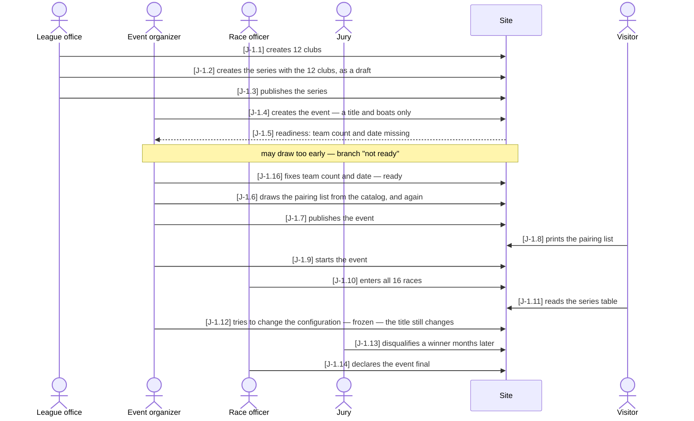
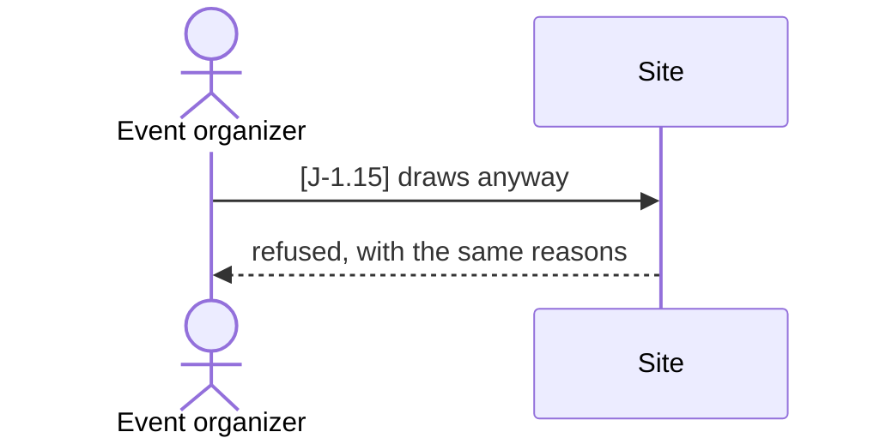

# J-1 ◐ From an empty series to a scored matchday

As the **association** I want **one test that walks the whole way — clubs, series, event,
boats, clubs entered, draw, start, all races sailed, standings, freeze, protest** — so that
**the steps are proven to fit together in the order they actually happen**. (Told first as
Story VA-9.)

Who: league office, event organizer, race officer, jury, visitor
(in the test, one league-office account acts as all four — the site's admin holds every relation)
Starting point: a running installation; none of the clubs, the series or the event exist.
Goal: a final event whose points survive a protest decided after the freeze.

### Main path

### Branch "not ready" — the organizer draws before the event is ready

Leaves the main path after J-1.5; it goes on at J-1.16.

| Step | Path | Story | Who | What is then true |
|---|---|---|---|---|
| J-1.1 | main | A-1 | league office | 12 clubs exist; none is public yet |
| J-1.2 | main | A-6 | league office | "Lifecycle Trophy 2026" with the 12 clubs, as a draft — 404 publicly |
| J-1.3 | main | VA-8 | league office | the series is published and listed |
| J-1.4 | main | VA-6 | event organizer | the event exists with a title and boats; the series' registrations are its entries |
| J-1.5 | main | VA-8 | event organizer | the readiness lists what is missing: team count, date |
| J-1.15 | not ready | VA-8 | event organizer | the draw is refused with `event-not-ready`, carrying the same codes |
| J-1.16 | main | VA-8 | event organizer | team count and date fixed; the event is ready |
| J-1.6 | main | VA-7 | event organizer | a pairing list from the catalog; a second draw replaces it |
| J-1.7 | main | VA-8 | event organizer | the event is in the public calendar |
| J-1.8 | main | B-3 | visitor | the pairing list prints — or the server says it cannot, never silently |
| J-1.9 | main | VA-8 | event organizer | the event is `live` |
| J-1.10 | main | WL-2 | race officer | 16 races entered; the points add up to what 16 races hand out |
| J-1.11 | main | B-1 | visitor | the series table has the act in it, every club with its placement |
| J-1.12 | main | VA-8 | event organizer | the configuration is frozen; a typo in the title is still fixable |
| J-1.13 | main | WL-2 | jury | a winner disqualified; the points follow on write |
| J-1.14 | main | VA-10 | race officer | the event is `final` |

Retired steps: none

It runs the catalog's **smallest** configuration (12 clubs, 6 boats, 8 flights = 16
races), not the league's 48 — small enough to sail to the end in a test, large enough to be
a real pairing list. Through the HTTP API only, nothing reached around into the database,
and deliberately **one long test**: a step that only makes sense after the previous one
cannot be a test that runs on its own. The browser half — that each step is *reachable*,
with its button enabled at the right moment — is in `e2e/lifecycle.spec.ts` per story, not
yet as one walk. ◐ and not ●, because WL-2 is not finished yet.

Tests: `api/tests/stories/test_complete_lifecycle.py::TestTheCompleteLifecycle::test_from_an_empty_series_to_a_scored_matchday`
