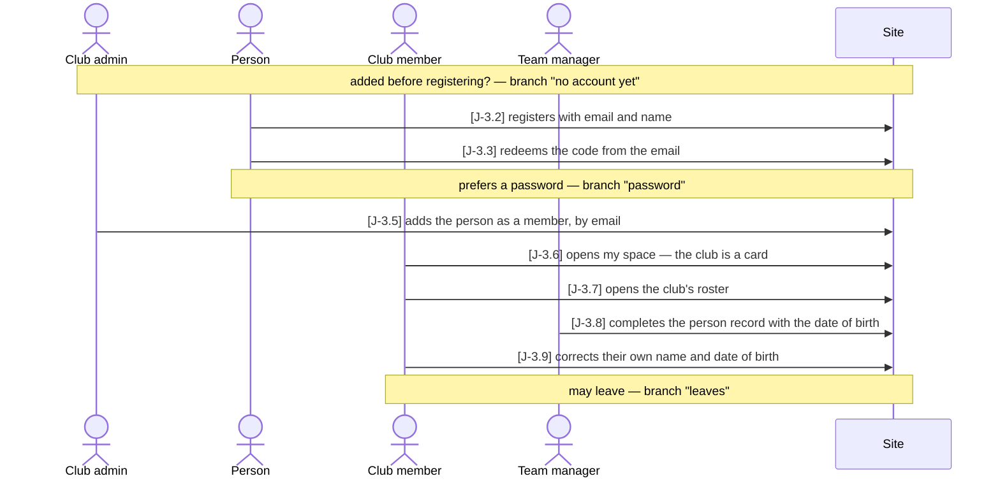
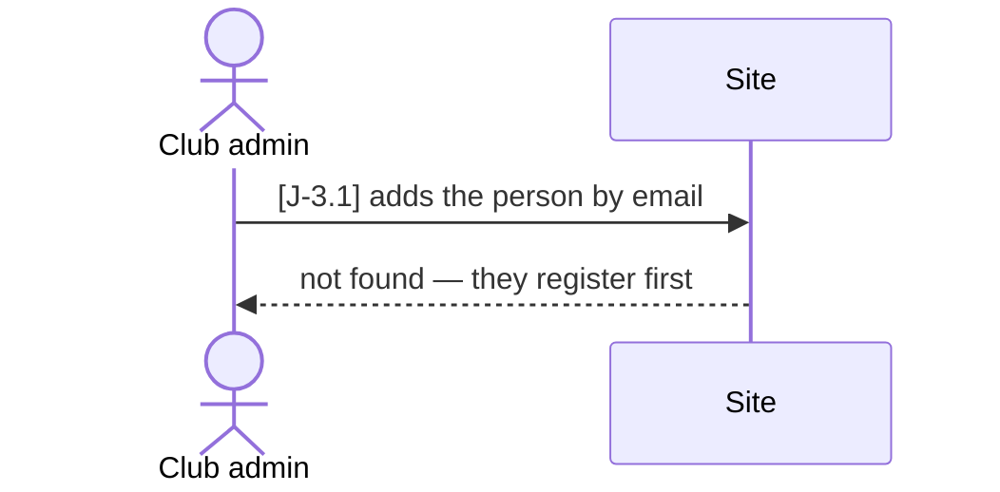
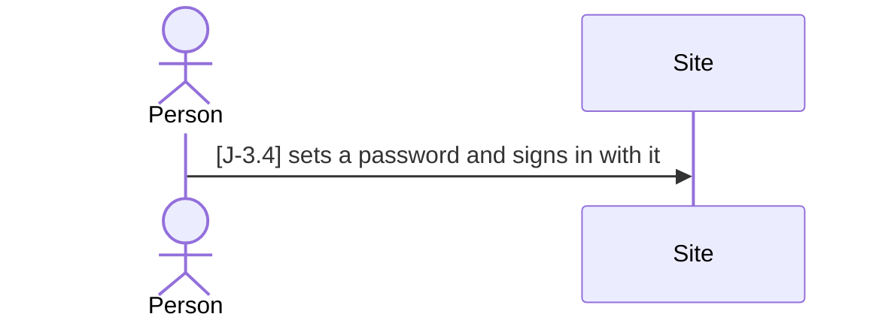
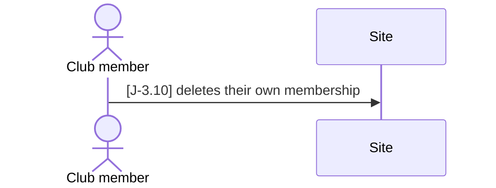

# J-3 ◐ A sailor joins their club

As a **club** I want **a new sailor to go from no account at all to a member of the club
with their own person record** — so that **the person can sign in, see their club and be
put in a squad, without anyone at the league office doing it for them**.

Who: club admin, person, club member, team manager
Starting point: the club exists and has a club admin and a team manager; the new sailor has
no account and is on no record.
Goal: the person is a member of the club, signs in to their own person record and has
corrected it themselves — and can leave the club on their own.

### Main path

### Branch "no account yet" — the club admin is too early

Before J-3.2: the person has to register first.

### Branch "password" — a password instead of a code each time

After J-3.3; the main path goes on at J-3.5.

### Branch "leaves" — the member leaves the club

At any time after J-3.5.

| Step | Path | Story | Who | What is then true |
|---|---|---|---|---|
| J-3.1 | no account yet | V-9 | club admin | refused with 404 — nobody is on record under the address; nobody is added |
| J-3.2 | main | Z-4 | person | an account exists, its address only claimed; a code is mailed — the same answer for a known address |
| J-3.3 | main | Z-4 | person | the address is verified; the account has its own person record (#40), no role and no club |
| J-3.4 | password | Z-9 | person | a password is set; signing in with it gives a token |
| J-3.5 | main | Z-5 | club admin | an active membership of the person — at once, no acceptance step while they are in no other club |
| J-3.6 | main | Z-8 | club member | my space lists the club with the chip *member*; the person record has no date of birth yet |
| J-3.7 | main | V-10 | club member | the roster shows the club's people by display name, no email |
| J-3.8 | main | V-4 | team manager | the member's person record carries a date of birth — the club's to change, being its member |
| J-3.9 | main | S-2 | club member | their own record (`Person.user_id`) carries the corrected name and date |
| J-3.10 | leaves | Z-5 | club member | the membership is gone; the club is no longer in my space; the person record stays |

Retired steps: none

The person becomes a *club member* the moment the club admin adds them (J-3.5): an active
`ClubMembership` of their person, which every account has from its first verified sign-in
(#40, `docs/PLAN_PEOPLE.md`) — until 2026-10-26 membership was a tuple on the account and
the sailor record a separate row the team manager created, tied to it by the email address.
◐ and not ●, because S-2 is ◐.

Drawing this journey found that V-4 promised "an organizer creates only people of their
own club" while any club's manager could *edit* anyone. Since 2026-10-17 creating stays
open to every club's manager (a new person has no club yet), and changing a person
(J-3.8 onwards) is for the managers of a club whose squad holds them (`sailor-not-yours`).

Tests: `api/tests/stories/test_journey_member.py::TestASailorJoinsTheirClub::test_from_no_account_to_a_member_with_a_sailor_record`
