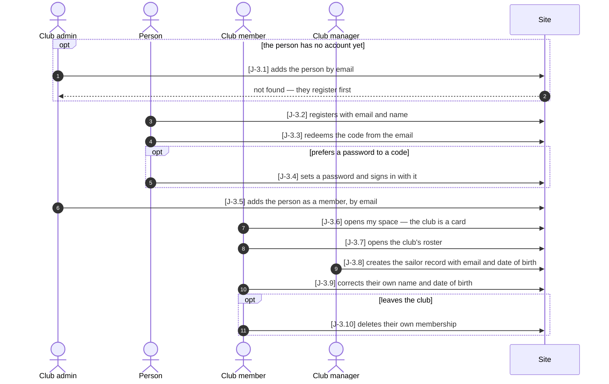

# J-3 ◐ A sailor joins their club

As a **club** I want **a new sailor to go from no account at all to a member of the club
with their own sailor record** — so that **the person can sign in, see their club and be
put in a squad, without anyone at the league office doing it for them**.

Who: club admin, person, club member, club manager
Starting point: the club exists and has a club admin and a club manager; the new sailor has
no account and no sailor record.
Goal: the person is a member of the club, signs in to their own sailor record and has
corrected it themselves — and can leave the club on their own.

| Step | Path | Story | Who | What is then true |
|---|---|---|---|---|
| J-3.1 | no account yet | V-9 | club admin | refused with 404 — an account must exist; nobody is added |
| J-3.2 | main | Z-4 | person | an account exists, its address only claimed; a code is mailed — the same answer for a known address |
| J-3.3 | main | Z-4 | person | the address is verified; the account has no role and no club |
| J-3.4 | password | Z-9 | person | a password is set; signing in with it gives a token |
| J-3.5 | main | Z-5 | club admin | a `member` tuple on the club — at once, no acceptance step |
| J-3.6 | main | Z-8 | club member | my space lists the club with the chip *member*; no sailor record is linked yet |
| J-3.7 | main | V-10 | club member | the roster shows the club's people by display name, no email |
| J-3.8 | main | V-4 | club manager | a sailor record with the person's address (lowercased) and date of birth |
| J-3.9 | main | S-2 | club member | the record, linked by the verified address, carries the corrected name and date |
| J-3.10 | leaves | Z-5 | club member | the member tuple is gone; the club is no longer in my space; the sailor record stays |

Retired steps: none

The person becomes a *club member* the moment the tuple is written (J-3.5) — the same
account, now holding a relation. The sailor record (J-3.8) is a separate row tied to the
account by nothing but the **verified** email address: membership does not create one, and
until it exists `GET /api/sailors/me` answers `no-linked-sailor-record`. ◐ and not ●,
because S-2 is ◐.

Drawing this journey found that V-4 promised "an organizer creates only people of their
own club" while any club's manager could *edit* anyone. Since 2026-10-17 creating stays
open to every club's manager (a new person has no club yet), and changing a person
(J-3.8 onwards) is for the managers of a club whose squad holds them (`sailor-not-yours`).

Tests: `api/tests/stories/test_journey_member.py::TestASailorJoinsTheirClub::test_from_no_account_to_a_member_with_a_sailor_record`
