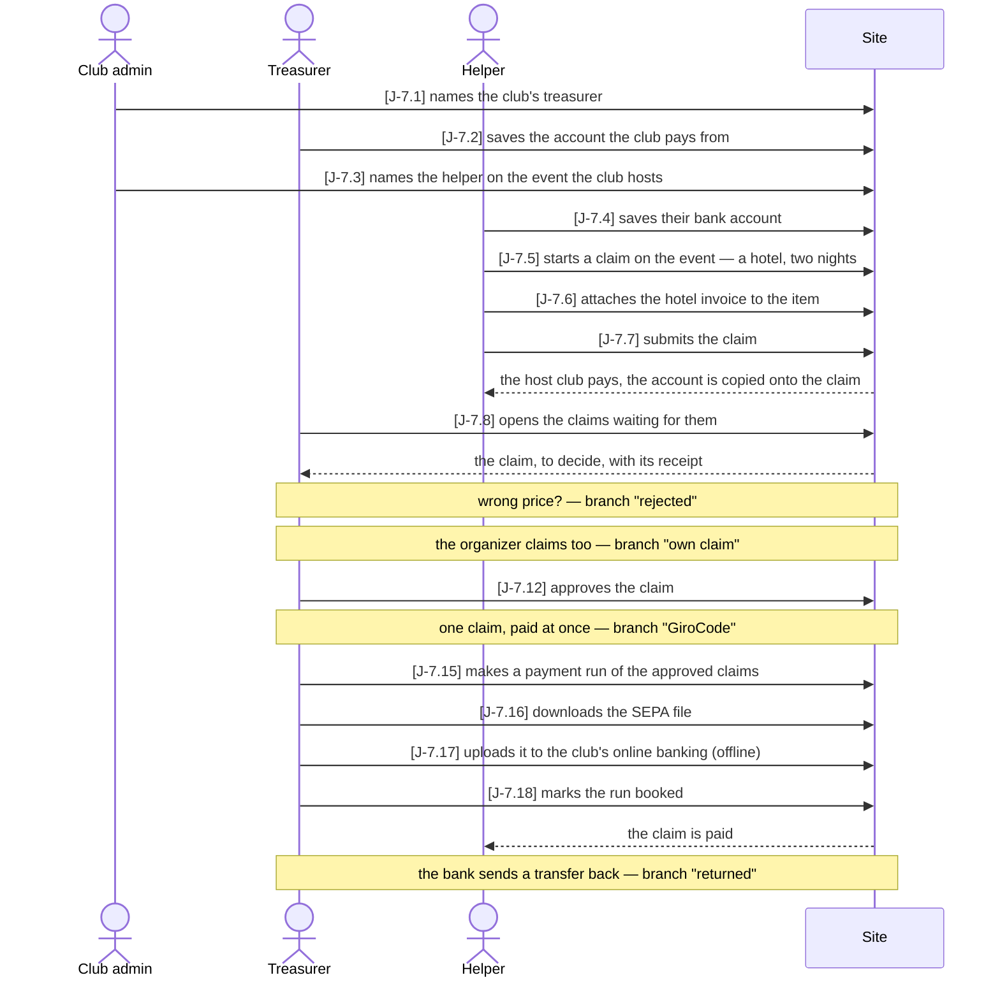
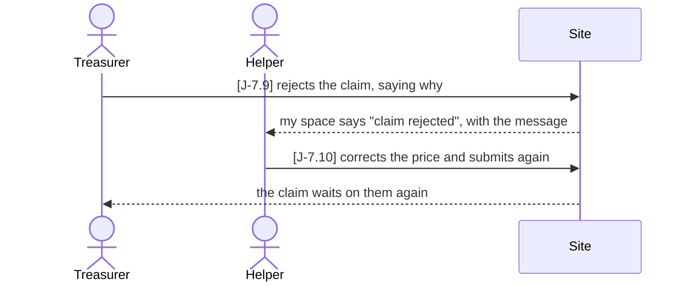
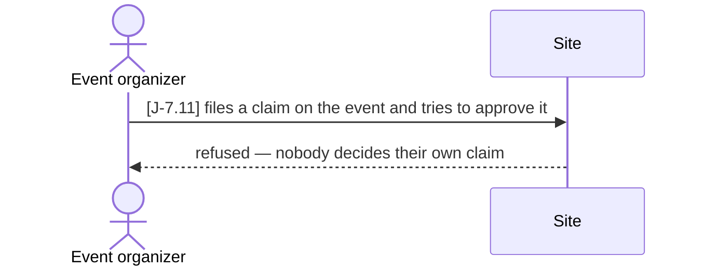
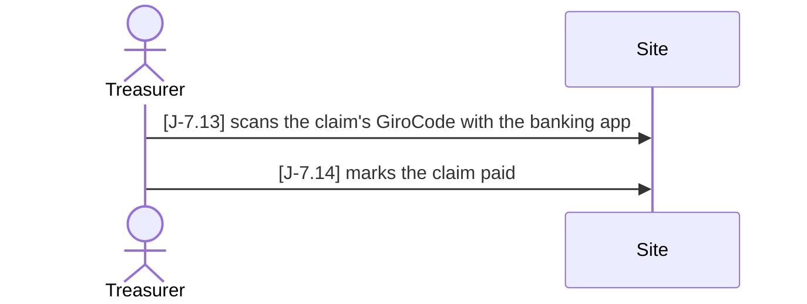
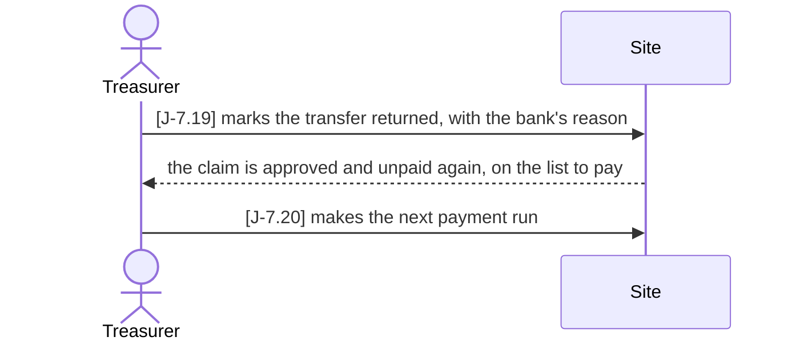

# J-7 ● From a claim to the bank

As a **club that hosts an event** I want **the people who worked it — helpers, race
officers, the jury — paid back what they spent, decided by our treasurer and paid through
one file for our bank**, so that **nobody types an IBAN, nobody decides their own claim,
and the club's books say what was paid to whom**.

Who: club admin, treasurer, helper, event organizer
Starting point: a club hosts an event (Journeys J-1 and J-4 make one). The club has an
admin. The treasurer-to-be and the helper have accounts and hold nothing yet.
Goal: the helper's approved claim is paid, and the claim reads `paid` — or, if the bank
returned the transfer, is back on the treasurer's list and in the next run.

### Main path — paid through a SEPA file

### Branch "rejected" — the treasurer finds a wrong price

After J-7.8; the main path goes on at J-7.12 with the corrected claim.

### Branch "own claim" — the event's organizer claims as well

After J-7.8; the organizer decides the helper's claim like the treasurer, but not their
own. The main path goes on at J-7.12.

### Branch "GiroCode" — one claim, paid by hand

After J-7.12, instead of a payment run; the journey ends here.

### Branch "returned" — the bank sends a transfer back

After J-7.18 (or before it, while the run is still open); the claim's next run is booked
like the first, J-7.18.

| Step | Path | Story | Who | What is then true |
|---|---|---|---|---|
| J-7.1 | main | F-1 | club admin | the person holds `treasurer` on the club — and so on every event the club hosts |
| J-7.2 | main | F-7 | treasurer | the club's account (holder, IBAN, BIC from the IBAN) is saved; only the treasurer and the club's admin read it |
| J-7.3 | main | VA-12 | club admin | the person holds `helper` on the event — the host club's admin is the event's admin; no power on the event, but a claim on it |
| J-7.4 | main | S-6 | helper | the helper's account is saved, checked by `schwifty`; only they read it |
| J-7.5 | main | F-2 | helper | the event is among the helper's claim targets; a draft claim with a hotel item over a range of dates — submitting it now is refused, the invoice is missing (`expense-document-missing`) |
| J-7.6 | main | F-5 | helper | the invoice is on the item, checked by content, under a random name |
| J-7.7 | main | F-2 | helper | `submitted`; the payer is the host club, holder and IBAN copied onto the claim |
| J-7.8 | main | F-6 | treasurer | the claim is on the treasurer's list, to decide, and its receipt opens for them |
| J-7.9 | rejected | F-3 | treasurer | `rejected` with the message; the helper's my space shows `claim_rejected` on the event |
| J-7.10 | rejected | F-2 | helper | the changed item makes the claim a draft; submitted again, it waits on the treasurer again |
| J-7.11 | own claim | F-3 | event organizer | the organizer may decide the helper's claim, but their own is refused (`claim-own-decision`) and not on their list |
| J-7.12 | main | F-3 | treasurer | `approved` at the claimed amount; the claim is frozen and on the list to pay |
| J-7.13 | GiroCode | F-8 | treasurer | the code carries the claim's copied account, the open amount and the line `C-<id> …`; never for the claimant |
| J-7.14 | GiroCode | F-4 | treasurer | one settled payment: the claim is `paid`, off the list, and has no code any more (`claim-not-payable`) |
| J-7.15 | SEPA file | F-7 | treasurer | one `issued` payment per payee; the claim reads `in_payment` and leaves the list to pay |
| J-7.16 | SEPA file | F-7 | treasurer | a pain.001.001.09 file: the club's IBAN as debtor, the helper's as creditor, the claim in the remittance line |
| J-7.17 | SEPA file | F-7 | treasurer (offline) | the bank has the file and the treasurer's TAN |
| J-7.18 | SEPA file | F-7 | treasurer | the run is settled; the claim reads `paid` |
| J-7.19 | returned | F-7 | treasurer | the payment is `failed` with its reason; the claim is approved and `unpaid`, back on the list to pay |
| J-7.20 | returned | F-7 | treasurer | the next run pays the claim again |

Retired steps: none

Open: the club's admin names the helper in J-7.3 because the access list is the event
admin's (VA-12); the event's own organizer — who holds `manager`, not `admin` — cannot,
though VA-12 is told as the organizer's story. Whether a manager should name the day's
helpers is for the stakeholder. A payment cancelled before it was issued, and partial
payments by hand, are still open in F-4 and so not steps.

Tests: `api/tests/stories/test_journey_money.py::TestFromAClaimToTheBank::test_rejected_once_paid_by_a_sepa_file_and_one_transfer_returned`,
`api/tests/stories/test_journey_money.py::TestFromAClaimToTheBank::test_the_organizer_cannot_decide_their_own_and_one_claim_paid_by_girocode`
