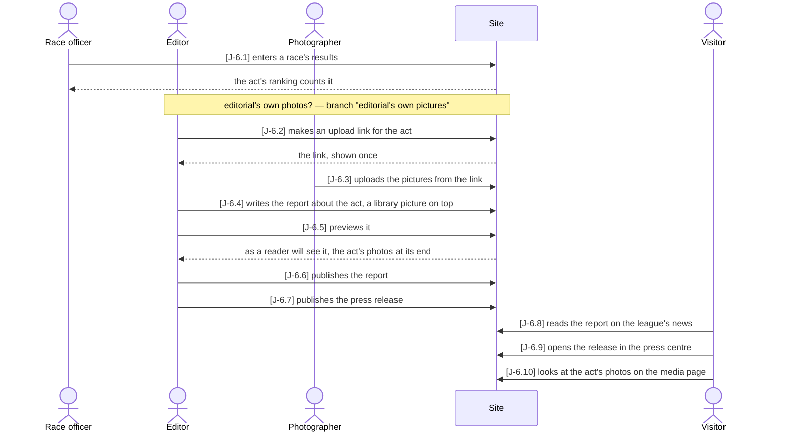
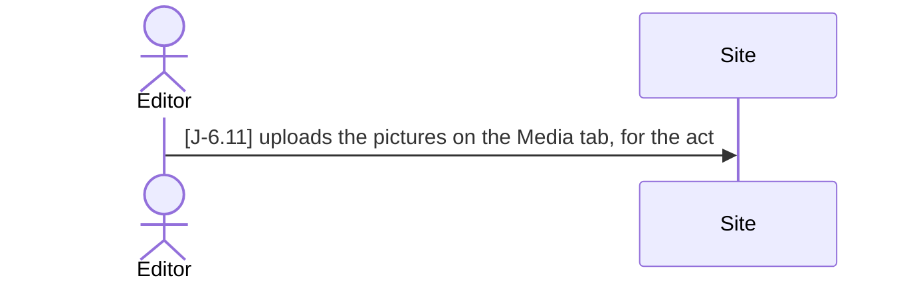

# J-6 ◐ From a sailed race to the report and the press release

As the **association** I want **a matchday to turn into a report with its photos and a
press release the same evening, written by editorial and fed by the race committee's
results and a photographer's pictures** — so that **the press and the fans read about a
regatta while it still matters, and nobody waits for a developer to put a text online**.

Who: race officer, editor, photographer, visitor
Starting point: a published matchday is being sailed; editorial (the site's `editor`) has
an account; the photographer has none.
Goal: the race is scored, the act's photos are in the library and on the league's media
page, and a published report — ending with those photos — and a published press release
are on the league's news page and in its press centre.

### Main path — the photographer sends the pictures

### Branch "editorial's own pictures" — editorial took or received the photos itself

After J-6.1, instead of J-6.2 and J-6.3; the main path goes on at J-6.4.

| Step | Path | Story | Who | What is then true |
|---|---|---|---|---|
| J-6.1 | main | WL-2 | race officer | the race is scored: the act's public page counts one more race (`races_scored`) |
| J-6.2 | main | R-2 | editor | an upload link for the act exists; the key is shown once and says what its pictures are for |
| J-6.3 | main | R-2 | photographer | the pictures are in the library, the act's, under the link's credit |
| J-6.11 | editorial's own pictures | R-2 | editor | the pictures are in the library, the act's, under editorial's credit |
| J-6.4 | main | R-1 | editor | the report is a draft about the act, its picture from the library — 404 publicly |
| J-6.5 | main | R-1 | editor | the preview shows the report with the act's photos at its end; nothing is stored |
| J-6.6 | main | R-1 | editor | the report is published |
| J-6.7 | main | R-1 | editor | the press release is published for the league |
| J-6.8 | main | R-1 | visitor | the league's news lists the report; its page ends with the act's photos |
| J-6.9 | main | R-1 | visitor | the league's press centre lists the release, and its text opens |
| J-6.10 | main | R-3 | visitor | the league's media page shows the act's photos with their credit |

Retired steps: none

Open: the press centre's *press kit*, *print photos* and *accreditation* are text cards
without files (`web/src/content`), and a picture at its full size is editorial's to
download (R-2) — the press cannot fetch one itself. Whether the press gets downloads of
its own is not decided. Results reach a report by editorial reading them: nothing drafts
a report from a matchday's results.

Tests: `api/tests/stories/test_journey_press.py::TestFromARaceToThePress::test_the_photographer_sends_the_pictures`
