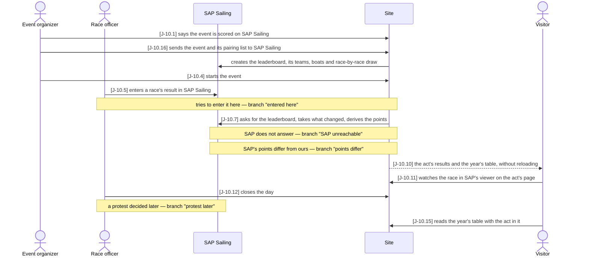
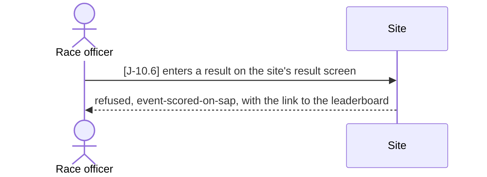
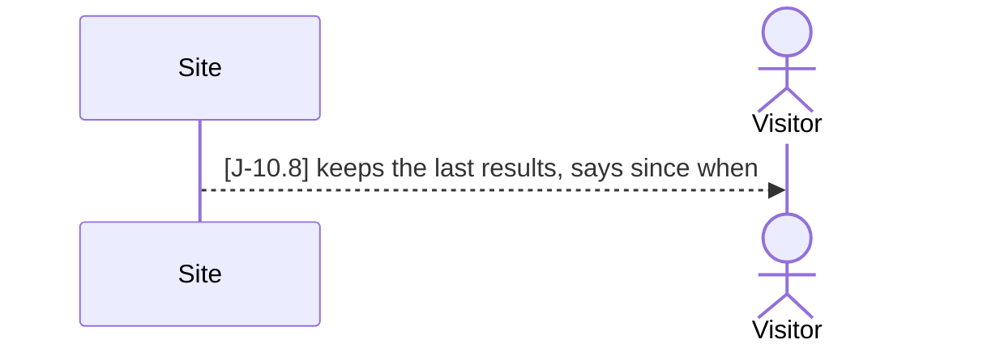
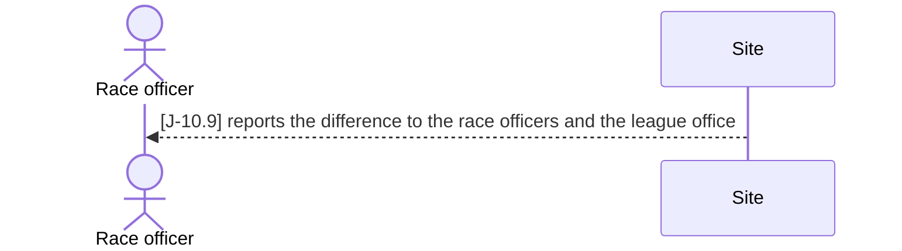
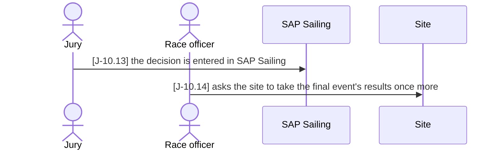

# J-10 ◐ A matchday scored live on SAP Sailing

As the **association** I want **a league matchday scored on SAP Sailing Analytics, which
SAP hosts for us, and shown on our site as it happens** — so that **the race committee
works in one scoring system, and the fans still find every result, the tables and the
race itself on the league's own pages**.

Agreed with SAP on 2026-11-01 for the 2027 season. Each step is a story of its own; what
the journey holds together is the **hand-over between the two systems** —
configuration flows to SAP, results flow back: before the day the organizer sends the
event and its pairing list to SAP, which creates the leaderboard, a result typed into SAP is the result on the act's
page half a minute later, the points are still derived here, and a protest decided in SAP
weeks later still reaches the year's table. Our own result entry stays for every event not
scored on SAP (J-1, J-8).

Who: event organizer, race officer, jury, visitor, sap sailing
Starting point: a published league year with a planned act — its teams entered, its
pairing list drawn (J-1) — and SAP Sailing's server reachable for our sends.
Goal: the act is final, its results came from SAP alone, and the year's table includes it.

### Main path

### Branch "entered here" — the race officer types the result into the site

After J-10.5; the result is entered in SAP, and the main path goes on at J-10.7.

### Branch "SAP unreachable" — SAP does not answer

At J-10.7; the next ask that succeeds takes everything missed, and the main path goes on.

### Branch "points differ" — SAP's net points are not the site's

At J-10.7; the site's points stand, the main path goes on.

### Branch "protest later" — a jury decision after the day

After J-10.12; the main path ends at J-10.15 with the decision in the table.

| Step | Path | Story | Who | What is then true |
|---|---|---|---|---|
| J-10.1 | main | VA-14 | event organizer | the event's results are to come from SAP Sailing |
| J-10.16 | main | VA-15 | event organizer | SAP has the event, its teams, boats and our pairing list; the leaderboard's name is stored on the event |
| J-10.4 | main | VA-8 | event organizer | the event is live |
| J-10.5 | main | WL-5 | race officer (offline) | a race's result is in SAP Sailing |
| J-10.6 | entered here | WL-5 | race officer | refused with `event-scored-on-sap`, nothing changed here |
| J-10.7 | main | WL-5 | site | within 30 s the raw result is here and the points derived |
| J-10.8 | SAP unreachable | WL-5 | site | the last results stay, "as of 14:32" |
| J-10.9 | points differ | WL-5 | site | the difference is reported, the site's points stand |
| J-10.10 | main | B-5 | visitor | the open pages show the result without reloading |
| J-10.11 | main | B-20 | visitor | the race is on the act's page in SAP's viewer |
| J-10.12 | main | VA-10 | race officer | the event is final |
| J-10.13 | protest later | WL-5 | jury (offline) | the decision is in SAP Sailing |
| J-10.14 | protest later | WL-5 | race officer | the final event's results include the decision |
| J-10.15 | main | B-1 | visitor | the year's table includes the act |

Retired steps:
- J-10.2 — the site matched each SAP competitor to a team by club code; the send (J-10.16)
  creates the competitors from our teams, so there is nothing to match.
- J-10.3 — branch "club unmatched"; gone with J-10.2.

Open:
- **Questions for SAP** (Axel): an account and permission on SAP's server for our sends
  (VA-15), and whether the API needs a key and has limits; whether boats are created by
  API (`/api/v1/boats`) or must exist on SAP first; the matchday's structure — 16 flights
  as race columns of 3 fleets each — and whether SAP's leaderboard takes it as is; listing
  our domains in the server's frame-ancestors setting so the race viewer can be embedded
  (B-20); a push or a stream instead of asking every 10–30 s; whether the race committee
  enters penalties, redress and jury decisions in SAP too.
- **Who closes the day** — the race officer here (VA-10), or the site when SAP marks the
  leaderboard final.
- **A difference in points** (J-10.9): reported only, or does the event's readiness block
  closing until someone looks?

Tests: `api/tests/stories/test_journey_sap_scored.py::TestAMatchdayScoredOnSap::test_from_the_send_to_the_years_table` — against the local SAP Sailing (`deploy/sap-local/`), skipped when none
runs; J-10.9 in `api/tests/stories/test_sap_send.py`, against the same SAP. No imitation
of SAP: the one we had hid what SAP's leaderboard really answers (docs/gotchas)
