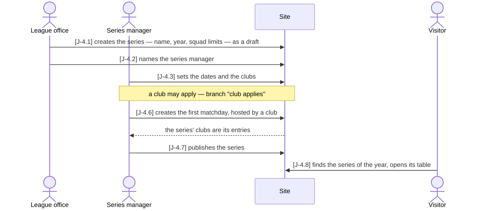
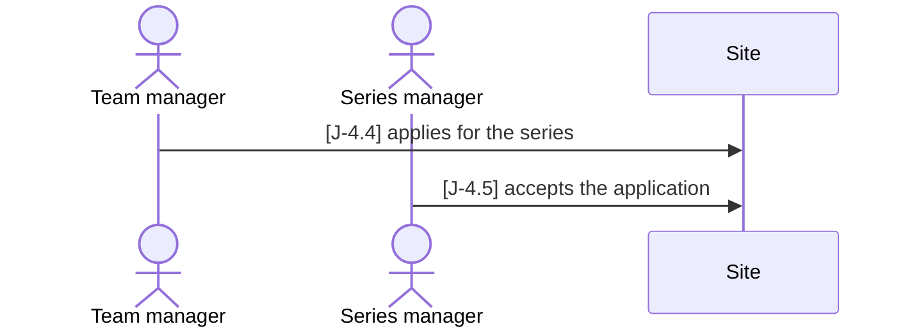

# J-4 ◐ An organizer sets up a series

As the **association** I want **to create a series and hand it to its own organizer, who
sets it up from there — dates, clubs, the first matchday, publication** — so that **a cup
run by someone other than the league office needs the league office twice, not for every
change**.

Who: league office, series manager, team manager, visitor
Starting point: the clubs exist; the series does not; the series manager has an account
and no relation yet.
Goal: a published series with its clubs and its first matchday, run by its manager.

### Main path

### Branch "club applies" — a club asks to join the series

After J-4.3; the main path goes on at J-4.6, the club among the entries.

| Step | Path | Story | Who | What is then true |
|---|---|---|---|---|
| J-4.1 | main | A-6 | league office | the series exists with its year and squad limits, no clubs, as a draft — 404 publicly |
| J-4.2 | main | Z-2 | league office | the person holds `manager` on the series; their admin list shows this series and no other |
| J-4.3 | main | A-6 | series manager | the series has its dates and its clubs; creating another series is refused (403) |
| J-4.4 | club applies | V-5 | team manager | an application, `requested` — not among the series' clubs |
| J-4.5 | club applies | A-9 | series manager | the club is a participant |
| J-4.6 | main | VA-6 | series manager | act 1 exists with its host club; the series' clubs, the accepted one included, are its entries |
| J-4.7 | main | VA-8 | series manager | the series is published |
| J-4.8 | main | B-1 | visitor | the series is listed for its year and its table opens |

Retired steps: none

What the series manager may do with the one `manager` tuple on the series, and nothing
more: edit it (`PATCH`), set its clubs, decide the applications to it, publish and unpublish
it, and create its events —
whose manager they then are too, through the series. Creating a series stays the league
office's (`require_admin`).

Tests: `api/tests/stories/test_journey_series.py::TestAnOrganizerSetsUpASeries::test_from_a_draft_to_the_public_table`
