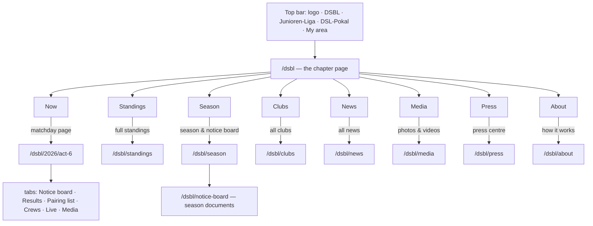

# Site structure — pages, URLs, what expands

**Decided 2026-10-11:** option E of issue #14, *"chapters on top, depth behind"*, in the
look of wireframe 8 (*"Chapters"*, issue #13). This file is the lasting record of that
concept; the issues hold the discussion and the alternatives. Nothing here is built into
the real site yet. A clickable prototype runs under **`/prototype`**
(`web/src/prototype/`), the wireframes under **`/wireframes`**. Both use invented content
and are thrown away once the real pages exist.

## What the site is

One application for the association's three competitions and for the association itself:

| Competition | Path | Made of |
|---|---|---|
| **DSBL** — Deutsche Segel-Bundesliga | `/dsbl` | two series a year: 1. Liga (18 clubs, 6 matchdays) and 2. Liga (18 clubs, 5 matchdays) |
| **Junioren-Liga** — Deutsche Junioren Segel-Liga | `/junioren-liga` | one series a year, AK16–AK21 |
| **DSL-Pokal** | `/dsl-pokal` | one event a year, autumn |
| the association, Deutsche Segel-Liga e.V. | `/` | its own pages |

The association's members are the 36 clubs of the 1. and 2. Liga. The last four of the
1. Liga go down and the first four of the 2. Liga go up. Places 13–18 of the 2. Liga have
to requalify at the DSL-Pokal.

## The one navigation row

Every page has the same row at the top, and only one: the **logo** (the association's
home) · **DSBL · Junioren-Liga · DSL-Pokal** · **My area** at the right. Topics such as
results, media and press are not in the row. Each one is a chapter of the league's page
and has a full page behind that chapter. An earlier row of topics under the league bar
made two navigation rows and was dropped (#13).

On a chapter page the row lies over the picture. On a depth page it is solid and sticky,
and (layout A) it carries the league's pages itself: **logo · DSBL ▾ · Standings · Season ·
Notice board · Clubs · News · Media · Press · About · My area**. The league becomes a
switch, so there is room for its pages beside it.

**At most two rows of navigation, ever.** The second exists only on a matchday page: it
names the matchday (*"Act 5 · Berlin, 18–20 Sep"*) and lists what it has (*notice board,
results, pairing list, crews, live, media*). It sticks under the first, so which matchday
you are on and what else it has stay in view while you scroll. A separate row of the
league's pages under the bar made three rows on a matchday page and was dropped
(2026-10-11), and so was the breadcrumb: the top row already says where you are.

## The league's page: chapters

`/dsbl` is one page of full-screen chapters, each over its own picture, with a column of
dots on the right to jump between them. A thumb can slide along the dots, which shows
every chapter's name, and the page follows. Each chapter is a **preview** that ends in a
link to its **own page**. That link is what option E adds to option A.

| Chapter | Preview | Its page |
|---|---|---|
| **Now** | the running or next matchday: venue, host, divisions; links to live map, notice board, last results | the matchday page |
| **Standings** | top five of each division | `/:league/standings` |
| **Season** | every matchday of the year, with its state | `/:league/season` |
| **Clubs** | the clubs' short names | `/:league/clubs` |
| **News** | three headlines | `/:league/news` |
| **Media** | what there is to watch | `/:league/media` |
| **Press** | the latest releases | `/:league/press` |
| **About** | what the league is | `/:league/about` |

The association's home `/` is a chapter page as well: *Now* (every league's current
matchday), *Leagues*, *News*, *For clubs* (the association's service: run your own event
here), *About* (history, board, member clubs → `/about`).

## The depth pages

| URL | Content | Expands in place |
|---|---|---|
| `/:league/standings` | the full table of each division, side by side; promotion, relegation and requalification marked; archive by year | a row → its points per matchday |
| `/:league/season` | every matchday: dates, venue, host, divisions, state; calendar file | a matchday → its details and links into its tabs |
| `/:league/notice-board` | the **season's** documents: rules, notice of race, boats, entry | each group of documents |
| `/:league/clubs` | the clubs of each division | — |
| `/:league/news`, `/:league/news/:slug` | articles | — |
| `/:league/media` | videos and photo galleries | — |
| `/:league/press` | press releases, press kit, print photos, accreditation, contact | a release → its text and download |
| `/:league/about` | what the league is, what is at stake, the boat | — |
| `/about` | the association: history, board, member clubs | — |

## The matchday page

`/:league/:year/:act`, for example `/dsbl/2026/act-6`. The tab is the last path
segment (`…/act-6/results`), so every tab has its own URL. Without a tab the page opens
on *Results* once racing is done, and on *Notice board* before that.

| Tab | Content | Expands |
|---|---|---|
| **Notice board** | the matchday's announcements, newest first, marked by who issued them (race committee, jury, organizer); its documents (NoR, SIs, amendments) | an announcement → its text |
| **Results** | the ranking of the act; race by race | a flight → its three races, each in finishing order with the boats' colours |
| **Pairing list** | who sails which boat in which race | — |
| **Crews** | who sails for each club | a club → its crew |
| **Live** | the live map while racing, a replay afterwards | — |
| **Media** | the matchday's video and photos | — |

The matchday is also where its own notice board, media and press release belong: option
C's idea, kept inside E.

## URLs and redirects

- **The league's path is stable across years.** `/dsbl` is the current season, by the
  existing rule for "the current year" (the newest one not in the future). A past year is
  `/dsbl/2025/…`.
- **Short paths are redirects, never copies:** `/:league/live` goes to the running act,
  else the next one (`…/live`); `/:league/results` goes to the last act sailed
  (`…/results`); `/:league/notice-board` holds the season's documents and links on to the
  current act's own notice board.
- **Other domains only choose the league.** A domain for the DSBL, the Junioren-Liga or
  the Pokal redirects permanently (301) to its path, and the association's domain serves
  `/`. This is how vodafone.de folds in old brands: kabeldeutschland.de lands on the
  matching topic, not on the home page. Old paths are redirected to the matching new page
  as well.
- **Today's URLs** (`/series/:id`, `/events/:id`) redirect permanently to the new ones.
- Route words are English (`results`, `notice-board`). The league's slug is data.

## Design

Clean: white and slate, one accent (the brand blue), generous space, type doing the work.
Pictures carry the chapter pages. The depth pages are white; how their picture, title and
the way to the sibling pages are framed is still open (variant "Detail page" below). A
slideshow shows no slide marks: on a chapter they read as a second set of dots beside the
chapter dots.

## Variants still open

A development switch (the **DEV** button, bottom left, in the prototype) toggles these.
Each is to be decided on the real device, not argued in the abstract:

| Variant | Options |
|---|---|
| Chapters | **snap** — every chapter fills the screen and clicks into place; **free** — chapters keep their height but scroll freely |
| Pictures | **photo** · **fade** (cross-fade, slow zoom) · **slide** (pushed in from the right) · **video** (a muted loop; only the chapter on screen plays) |
| Detail page | **A band** — a slim picture band, content on white, the league's pages in the top row · **B sheet** — a big picture with a big title, the content a white sheet sliding up over it, the league's pages as sticky pills at its top edge (three rows on a matchday page) · **C split** — picture, title and the league's pages fixed on the left, the content scrolling on the right (on a phone: a compact head with pills) |
| Title (in A) | **on picture** — white on the band · **below** — the band is mood only, the title dark on white under it |

## Content sources

- **deutsche-segelliga.de** is the user's own site. Its texts (competitions, about, board,
  member clubs, news) and pictures may be taken over and copied here.
- **deutsche-segelbundesliga.de** belongs to the league's GmbH. Its photos are **linked,
  never copied**, because this repository is public. Its YouTube videos are embedded.

## Open before the real build

From #14, still unanswered:

1. **"DSBL" spans two series a year.** `/dsbl` needs something that groups a year's
   series under one league and links the years together. This is a model question, to be
   decided before the routes are built.
2. Which domains exist or are planned.
3. Who writes news and press releases, and whether they need a review before publishing.
4. Videos on YouTube (embedded) or hosted here; galleries uploaded here or linked.
5. Whether the notice of race declares this site the official notice board. If it does,
   entries get timestamps, are never edited silently, and an amendment is a new entry.
6. How far back the archive goes.

Each piece becomes a story in `docs/userstories/` before it is built.
