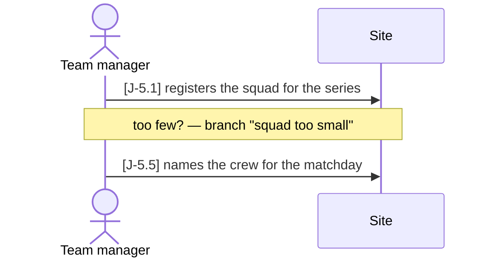
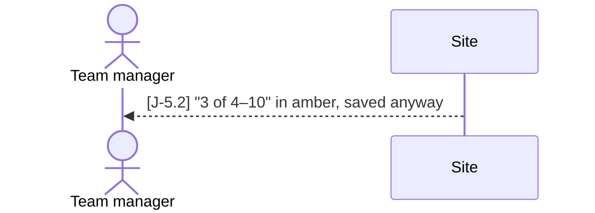

# Journeys

Part of the [user stories](README.md); the status marks and the identifier rule are
explained there.

A **journey** is several stories in the order they really happen, across the people who
take part — a use case's *main success scenario* (Cockburn), laid along the backbone of a
story map (Patton). Every step is already a story with its own tests; what a journey adds
is the **sequence**: that each step's output really is the next step's input. That is
what breaks in practice — a draw keyed on teams while the clubs are added after creation,
an event saved without a date because the date is agreed later — each fine alone, wrong in
order.

Each journey is **one file in [`docs/journeys/`](../journeys/)**, with a sequence diagram
stakeholders can read and a step table the tests are held to. The chain it starts is
**journey → story → tests → help → report**, generated into
[`docs/traceability.md`](../traceability.md#journeys); the `journey` skill
(`.claude/skills/journey/`) writes and extends journeys.

## The journeys

| Journey | File | Who |
|---|---|---|
| J-1 From an empty series to a scored matchday | [lifecycle.md](../journeys/lifecycle.md) | league office, event organizer, race officer, jury, visitor |
| J-2 A new club gets going and runs itself | [club.md](../journeys/club.md) | league office, club admin, team manager, visitor |
| J-3 A sailor joins their club | [member.md](../journeys/member.md) | person, club admin, club member, team manager |
| J-4 An organizer sets up a series | [series.md](../journeys/series.md) | league office, series manager, team manager, visitor |
| J-5 A club's crew is cleared for a matchday | [crew-cleared.md](../journeys/crew-cleared.md) | team manager, sailor, guardian, event organizer, visitor |
| J-6 From a sailed race to the report and the press release | [press.md](../journeys/press.md) | race officer, editor, photographer, visitor |
| J-7 From a claim to the bank | [money.md](../journeys/money.md) | club admin, treasurer, helper, event organizer |
| J-8 A club hosts its own event | [hosted-event.md](../journeys/hosted-event.md) | team manager, club admin, event organizer, league office, race officer, visitor |
| J-9 A fan follows an act | [fan.md](../journeys/fan.md) | visitor |

## Actors

The people (and the one system) a journey may name — in its `Who:` line, in the `Who`
column and as the diagram's participants. **Only these**, spelled like this, so a step's
actor always says which relation the person holds, which story file tells their stories
and which help audience reads about it. An actor is defined by what someone **holds or
does**, never by a job title: one person is often several actors (a club admin who also
sails), and a journey shows them as the actor of each step.

| Actor | Alias | Is someone who … | Relation (Story Z-2) | Stories | Help audience |
|---|---|---|---|---|---|
| visitor | V | reads the public site, signed in or not | — | [visitor.md](visitor.md) | visitor |
| person | N | has an account and nothing else yet — just registered | — | [sailor.md](sailor.md) | sailor |
| club member | M | belongs to a club | `member` on the club | [sailor.md](sailor.md) | sailor |
| sailor | S | is in a squad or a crew | — (a `Team` row, Story V-1) | [sailor.md](sailor.md) | sailor |
| guardian | G | accepts the waiver for a minor sailor — online once the child's club linked their account, else on paper | `guardian` on the sailor (V-13) | [sailor.md](sailor.md) | sailor |
| club admin | CA | decides who is *in* a club: members, organizers, crest | `admin` on the club | [club.md](club.md) | club |
| team manager | TM | decides who *sails*: participation, squads, crews | `manager` on the club | [club.md](club.md) | club |
| treasurer | T | decides and pays expense claims | `treasurer` on a club or an event | [treasurer.md](treasurer.md) | treasurer |
| series manager | SM | runs one series: its clubs, dates, events | `manager` on the series | [event-organizer.md](event-organizer.md) | event-organizer |
| event organizer | O | runs one event: configuration, draw, check-in | `manager` on the event (or its series, or its host club) | [event-organizer.md](event-organizer.md) | event-organizer |
| helper | H | works the day without power over it | `helper` on the event | [event-organizer.md](event-organizer.md) | event-organizer |
| race officer | R | runs the races and enters results | `race_officer` on the event, series or site | [race-committee.md](race-committee.md) | race-committee |
| jury | JY | decides protests | `jury` on the series or event | [race-committee.md](race-committee.md) | race-committee |
| league office | A | runs the site: clubs, series, accounts | `admin` on the site (until 2026-10-24 also `editor`) | [administration.md](administration.md) | administration |
| editor | ED | writes the site's news and press releases and keeps its pictures | `editor` on the site, a series or an event (their `admin` too) — organizes nothing | [editorial.md](editorial.md) | administration |
| photographer | PH | delivers pictures through an upload link, without an account | — (an import key, Story R-2) | [editorial.md](editorial.md) | — |
| site | P | the system itself — answers, refuses, shows | — | — | — |

In the diagram an actor is `actor <Alias> as <Actor>` (`site` is `participant P as Site`),
capitalised as a name. In the table, a step done by either of two actors says
`sailor or team manager`; a step that happens away from the site adds `(offline)`. A new
actor is a new row here first — and then, usually, a new relation or story file.

## The format

````markdown
# J-5 ◐ A club's crew is cleared for a matchday

As a **club** I want … (why the journey matters, in a sentence or two)

Who: team manager, sailor, guardian, event organizer
Starting point: what exists before the first step
Goal: what is true at the end

### Main path



### Branch "squad too small" — fewer than the series' minimum

After J-5.1; saved anyway, completed later.



| Step | Path | Story | Who | What is then true |
|---|---|---|---|---|
| J-5.1 | main | V-1 | team manager | the squad is saved |
| J-5.2 | squad too small | V-1 | site | the minimum is guidance |
| J-5.5 | main | V-2 | team manager | the crew is named |

Retired steps: none

Open: decisions the journey made visible and nobody has taken yet.

Tests: `api/tests/stories/test_journey_crew.py::TestACrewIsCleared::test_adult_crew`
````

- **Step IDs `J-n.k`** — the journey's ID, a dot, a number. `k` is given once and **never
  renumbered or reused**: a new step takes the next free number even in the middle of the
  flow, because tests and help pages carry it. The table's order is the flow; the number
  is only a name.
- **A removed step** leaves the diagram and the table, and its ID goes on the
  `Retired steps:` line, so nobody gives it out again.
- **The table is the source of truth, the diagrams views of it**: every arrow carrying a
  `[J-n.k]` is one row, every row one such arrow — in exactly one diagram, and each
  diagram draws its steps in the table's order. An arrow without an ID (an answer, a
  `Note`) is reading aid and tested by nobody.
- **One diagram per way through, never an `opt` or `alt` block** (decided 2026-10-17):
  a block nests, and two or three of them in one diagram are what a stakeholder cannot
  read. The first diagram, **`### Main path`**, holds every `main` step — plus, where
  the journey forks into "one or the other", the usual arm, named after it in the
  heading (`### Main path — a series matchday, an adult crew`). Where a branch leaves
  it, a `Note` names the branch. Each branch then has its own **`### Branch "<path>" —
  <when>`**, a sentence saying where it leaves and where the main path goes on, and a
  diagram with just its steps and the actors in them. A branch of a branch is one more
  diagram, not a nested one.
- **`Path`** is `main` or the name of a branch — the name in its `### Branch "…"`
  heading. "One or the other" is two branch names; the shared spine is `main`.
- **No `;` in a diagram** — Mermaid ends a statement there, and GitHub then shows an
  error box instead of the diagram. No `autonumber` either: it counts again in every
  diagram, and the `[J-n.k]` is the step's name.
- **Every step names exactly one story** — a step whose story does not exist yet is the
  signal to write that story first (CLAUDE.md, "the story first").
- **Tests.** A *walk* is one long test whose stretches are `step("J-5.4", "…")` —
  `tests/journeys.py` in pytest, `describeJourney` + `step` from `e2e/fixtures.ts` in
  Playwright — listed on the journey's `Tests:` line. A walk takes every `main` step that
  is not offline, plus any branches, in the table's order; one journey may have several
  walks ("— minor crew"). A step can instead be covered by a story test that says
  `Journey step J-5.6` in its docstring.
- **Status:** ○ when no test walks it; ● when it is walked, every step that is not
  offline is covered by a walk or a docstring, and every step's story is ●; ◐ otherwise.
  A journey is never more finished than its weakest step.
- `scripts/check-docs.py` holds all of this, including the actors; a step no test covers
  is printed as a warning.
