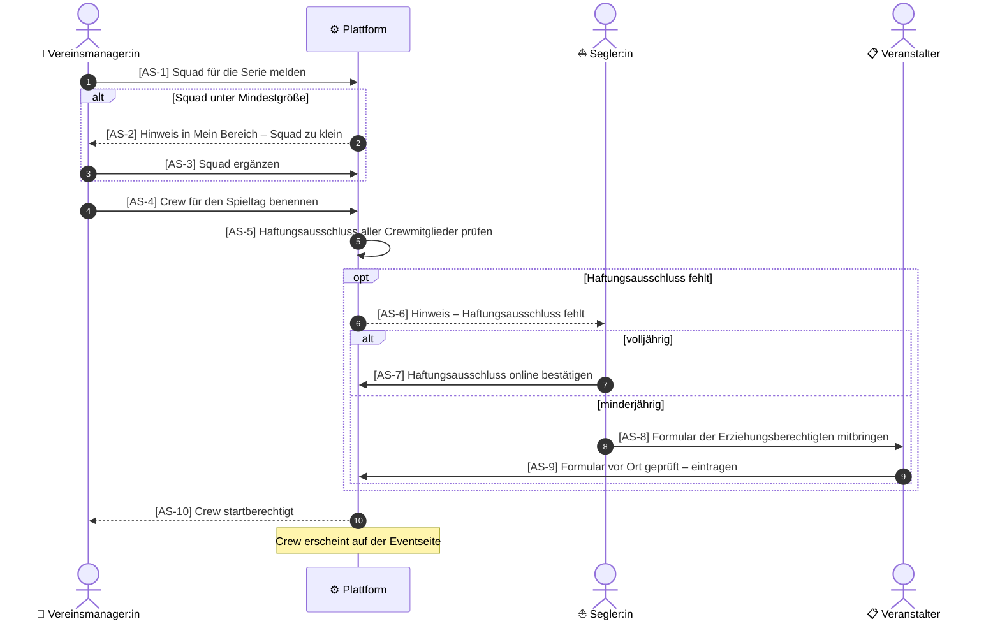

# Konzept: User Journeys als Sequenzdiagramme mit Testverknüpfung

**Repo:** `gundramleifert/segel-bundesliga`
**Zweck dieses Dokuments:** Arbeitsauftrag und Leitlinie für die Umsetzung, z. B. durch einen KI-Assistenten im Repo.

---

## 1. Ausgangslage

Das Repo hat bereits eine gute Grundlage:

- `docs/userstories/`: Stories pro Rolle, mit IDs (z. B. F-8), Status und zugeordneten Tests
- `api/tests/stories/`: ein Pytest-Test pro Story
- `e2e/`: Playwright-Tests, nach Story organisiert
- Allure-Report über beide Suites, gruppiert nach Story
- `docs/traceability.md`: generierte Liste Story → Tests
- Issue-Workflow mit Stakeholder-Abnahme auf Staging
- `CLAUDE.md` als Anleitung für KI-Assistenten

**Was fehlt:** die Ebene **über** den Stories. Gemeint sind Journeys, also Abläufe über mehrere Stories und Rollen hinweg, die für Stakeholder grafisch lesbar sind und mit den Tests verknüpft werden.

## 2. Entscheidungen

| Thema | Entscheidung | Begründung |
|---|---|---|
| Darstellung | **Mermaid-Sequenzdiagramme** in Markdown | GitHub rendert sie direkt (Dateien, Issues, PRs). Rollen und Übergaben sind klar sichtbar. Kein neues Werkzeug nötig. |
| Verzweigungen | `alt` / `else` / `opt` im Sequenzdiagramm | Bleibt lesbar. BPMN nur, wenn ein Ablauf damit nicht mehr darstellbar ist. |
| Schritt-Referenzen | **Feste Schritt-IDs** im Diagramm, z. B. `[AS-4]` | `autonumber` verschiebt sich beim Einfügen von Schritten. Feste IDs bleiben stabil. |
| Testformat | **Kein Gherkin** | Die Stories sind bereits Markdown, die Tests Pytest und Playwright. Ein zweites Format wäre Doppelpflege. |
| Report | Bestehendes **Allure** erweitern | Das Konzept der Living Documentation ist schon vorhanden. |
| Eingabe durch Stakeholder | **GitHub-Issue-Vorlage „Journey“** | Kein Syntax-Wissen nötig. Daraus wird im normalen Workflow die Journey-Datei. |
| Whiteboard | Nicht verwendet | Keine Verbindung zu Repo und Tests. |

## 3. Aufbau einer Journey-Datei

**Ablage:** `docs/journeys/<journey-slug>.md`, eine Datei pro Journey.

**Präfix:** Jede Journey hat ein kurzes, eindeutiges Präfix für ihre Schritt-IDs (z. B. `AS` = Anmeldung Spieltag). Die Präfixe stehen in `docs/journeys/README.md`.

**Regeln für Schritt-IDs:**
- Format: `[PRÄFIX-n]` am Anfang des Nachrichtentextes im Diagramm.
- IDs werden **nie umnummeriert und nie wiederverwendet**. Ein neuer Schritt bekommt die nächste freie Nummer, auch wenn er in der Mitte des Ablaufs steht.
- Entfallene Schritte werden aus dem Diagramm entfernt, die ID bleibt gesperrt (Liste „Entfallene IDs“ in der Datei).
- Interne Prüfungen der Plattform (`P->>P`) bekommen ebenfalls IDs, wenn sie getestet werden sollen.
- `autonumber` bleibt zusätzlich an, für die Reihenfolge im Review.

**Pflichtabschnitte:**
1. Kopf: Name, Präfix, beteiligte Rollen, Ziel (was am Ende erreicht ist)
2. Sequenzdiagramm
3. Schritttabelle: Schritt-ID → Rolle → Beschreibung → verknüpfte Story-IDs
4. Entfallene IDs (anfangs leer)

### Beispiel: `docs/journeys/anmeldung-spieltag.md`

> **Hinweis:** Der Ablauf ist aus der README abgeleitet. Vor dem Einchecken fachlich prüfen, insbesondere Schritt AS-9 (prüft der Veranstalter das Formular wirklich vor Ort und trägt es ein?). Die Story-IDs in der Tabelle sind Platzhalter (`?`) und müssen aus `docs/userstories/` ergänzt werden.

````markdown
# Journey: Anmeldung zum Spieltag

- **Präfix:** AS
- **Rollen:** Vereinsmanager:in, Segler:in, Veranstalter, Plattform
- **Ziel:** Die Crew eines Vereins ist für einen Spieltag startberechtigt und erscheint auf der Eventseite.



| Schritt | Rolle | Beschreibung | Stories |
|---|---|---|---|
| AS-1 | Vereinsmanager:in | Squad für die Serie melden | ? |
| AS-2 | Plattform | Hinweis bei zu kleinem Squad | ? |
| AS-3 | Vereinsmanager:in | Squad ergänzen | ? |
| AS-4 | Vereinsmanager:in | Crew für den Spieltag benennen | ? |
| AS-5 | Plattform | Haftungsausschluss prüfen | ? |
| AS-6 | Plattform | Hinweis an Segler:in | ? |
| AS-7 | Segler:in | Haftungsausschluss online bestätigen | ? |
| AS-8 | Segler:in | Formular mitbringen (minderjährig) | ? |
| AS-9 | Veranstalter | Formular prüfen und eintragen | ? |
| AS-10 | Plattform | Crew startberechtigt | ? |

## Entfallene IDs

– keine –
````

## 4. Verknüpfung mit Tests

Tests verweisen auf **Schritt-IDs**, nie auf die automatischen Nummern.

**Playwright (`e2e/journeys/<journey-slug>.spec.ts`):** ein Journey-Test pro Hauptpfad, Schritte über `test.step` mit ID am Anfang:

```ts
test('Anmeldung zum Spieltag – volljährige Crew', async ({ page }) => {
  await test.step('AS-1 Squad für die Serie melden', async () => { /* … */ });
  await test.step('AS-4 Crew für den Spieltag benennen', async () => { /* … */ });
  await test.step('AS-7 Haftungsausschluss online bestätigen', async () => { /* … */ });
  await test.step('AS-10 Crew startberechtigt', async () => { /* … */ });
});
```

Zusätzlich das Allure-Label `journey` mit dem Slug setzen, damit der Report nach Journey gruppieren kann.

**Pytest (`api/tests/stories/`):** bestehende Story-Tests bekommen einen Marker für die Schritte, die sie abdecken:

```python
@pytest.mark.journey_step("AS-5")
def test_crew_ohne_haftungsausschluss_wird_nicht_startberechtigt(): ...
```

Den Marker `journey_step` in der Pytest-Konfiguration registrieren und als Allure-Label übernehmen.

**Pfade:** Jeder Zweig eines `alt` oder `opt` braucht mindestens einen Test. Für das Beispiel sind das: Hauptpfad volljährig, Pfad minderjährig und Pfad „Squad zu klein“.

## 5. Traceability und Prüfungen

**`docs/traceability.md` erweitern** (das bestehende Generator-Skript ergänzen):
- Schritt-IDs per Regex `\[([A-Z]+-\d+)\]` aus allen `docs/journeys/*.md` lesen.
- Tests mit passender ID sammeln (Playwright-`test.step`-Titel, Pytest-Marker).
- Pro Journey eine Tabelle ausgeben: Schritt → Tests → Status aus dem letzten Allure-Lauf (bestanden / fehlgeschlagen / kein Test).

**Bestehendes Check-Skript erweitern** (tatsächlichen Namen im Repo verwenden):
- **Fehler**, wenn ein Test auf eine Schritt-ID verweist, die in keiner Journey existiert.
- **Fehler**, wenn eine Schritt-ID doppelt vergeben ist oder eine entfallene ID wieder auftaucht.
- **Warnung**, wenn ein Schritt keinen Test hat.

## 6. Eingabe durch Stakeholder

**GitHub-Issue-Formular** `.github/ISSUE_TEMPLATE/journey.yml` mit den Feldern:
- Name der Journey
- Beteiligte Rollen
- Ziel: Was ist am Ende erreicht?
- Ablauf in Stichpunkten: wer tut was, in welcher Reihenfolge
- Sonderfälle: Was passiert, wenn …?

Das Issue durchläuft den normalen Workflow. Daraus entstehen die Journey-Datei, fehlende Stories und Tests. Die Stakeholder nehmen das gerenderte Diagramm im PR oder auf Staging ab.

## 7. CLAUDE.md ergänzen

Kurzer Abschnitt mit diesen Regeln:
- Journeys liegen in `docs/journeys/`, Format wie in Abschnitt 3.
- Schritt-IDs nie umnummerieren oder wiederverwenden.
- Neue oder geänderte Funktionalität: betroffene Journey-Schritte prüfen und Tests mit `test.step('ID …')` bzw. `@pytest.mark.journey_step` verknüpfen.
- Jeder `alt`/`opt`-Zweig braucht einen Test.

## 8. Später: Anwendungsdoku per KI

Wenn Journeys und Tests stehen, kann daraus automatisch Nutzerdoku entstehen:
- Je Journey ein Kapitel, je Rolle eine Anleitung, aus Fehlerzweigen eine FAQ.
- Screenshots aus den Playwright-Journey-Tests einbinden.
- Nur aus Schritten mit grünen Tests generieren. Doku als PR zum Review, Veröffentlichung z. B. über GitHub Pages.

Das ist **nicht** Teil der ersten Umsetzung.

## 9. Umsetzungsschritte

Jeder Schritt kann ein eigenes Issue sein:

1. **Struktur:** `docs/journeys/README.md` mit Konventionen und Präfix-Liste anlegen.
2. **Erste Journey:** `anmeldung-spieltag.md` nach Abschnitt 3, Ablauf und Story-IDs fachlich prüfen.
3. **Testverknüpfung:** Pytest-Marker registrieren, Allure-Label `journey` setzen, erster Journey-E2E-Test in `e2e/journeys/`.
4. **Traceability:** Generator um die Journey-Tabellen erweitern.
5. **Checks:** Regeln aus Abschnitt 5 ins Check-Skript.
6. **Issue-Vorlage:** `journey.yml` anlegen.
7. **CLAUDE.md:** Abschnitt aus Kapitel 7 ergänzen.
8. **Weitere Journeys:** z. B. Spesen (Mitglied → Manager → Kassenwart → GiroCode/SEPA).

**Fertig ist die erste Ausbaustufe, wenn:** Die Journey „Anmeldung zum Spieltag“ auf GitHub als Diagramm sichtbar ist, alle Zweige Tests haben, `traceability.md` den Status pro Schritt zeigt und das Check-Skript bei einer falschen Schritt-ID fehlschlägt.

## 10. Offene Punkte

- Ablauf der Beispiel-Journey fachlich bestätigen (vor allem AS-9).
- Format der bestehenden Story-Dateien prüfen: Sollen Story-Dateien zusätzlich auf Journey-Schritte zurückverweisen?
- Sprache der Journey-Dateien (Deutsch für Stakeholder vs. Englisch wie Issues/PRs) festlegen.
