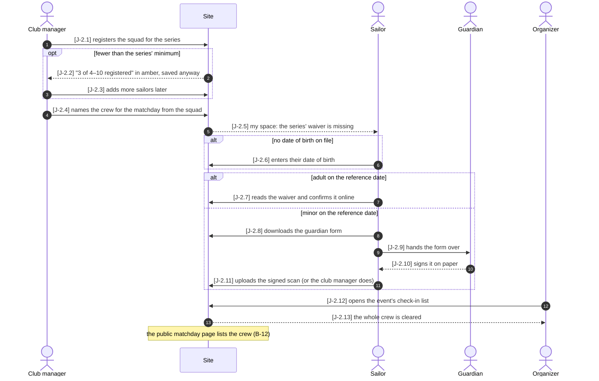

# Plan: journeys as sequence diagrams, linked to tests

Implementation plan for `konzept-jurney.md`. Written 2026-10-16 against `main` @ `893f063`.

---

## 0. What the concept misses: journeys already exist

The concept assumes there is nothing above the stories yet. There is, and most of its
infrastructure is already in place:

| The concept asks for | What already exists |
|---|---|
| A journey format | `docs/userstories/journeys.md`: `### J-1 ◐ …`, `Who:`, `Starting point:`, numbered `Steps:`, `Variations:`, `Tests:` |
| Steps in Playwright via `test.step` | `describeJourney("J-1: …")` + `step("VA-7", "…", fn)` in `e2e/fixtures.ts`, wrapping `test.step` |
| Steps in pytest | `step("VA-7", "…")` in `api/tests/journeys.py`, an Allure step each, closed by the hook in `api/tests/conftest.py` |
| Allure label `journey` | `describeJourney` already tags `@J-1` and labels it through `docs/stories.json` |
| Checks | `scripts/check-docs.py::check_journeys`: every step is a real story, the test walks the main steps in order, the ● / ◐ / ○ status follows from the weakest step |
| Traceability | `docs/traceability.md` already has a **Journeys** column per story |
| A first journey | J-1 "From an empty series to a scored matchday", walked by `test_complete_lifecycle.py` |

So this is **not** a new system next to the old one. It is an **extension of the existing
J- journeys**, which adds what they really lack:

1. **A diagram** stakeholders can read (today a journey is a numbered list of story IDs).
2. **Stable step IDs.** Today a step is keyed by its story ID, and one story can be several
   steps — VA-8 is step 3, 5, 7, 9 *and* 12 of J-1. A diagram arrow labelled `[VA-8]` cannot
   point at one of them, and neither can a test.
3. **Branches as tested paths.** Today variations are "alternatives, not steps of the test"
   and nothing checks that they are tested at all.
4. **A way for stakeholders to ask for a journey** (issue form).

## 1. Corrections to the concept

Each of these changes a decision in the concept. Each one is a consequence of something
already decided in `CLAUDE.md` or of the existing code.

| # | Concept says | Plan does | Why |
|---|---|---|---|
| C1 | Prefix per journey, step IDs `[AS-4]` | Step IDs **`J-2.4`** — the journey's own ID, a dot, a stable number | `AS-4` has the shape of a story ID (`[A-Z]+-\d+`), and `check-docs.py` reports every such token in a test that is not a story. A second prefix namespace would also collide with the story letters (`A`, `S`, `V`…). `J-n` is already the journey's permanent ID; `J-2.4` needs no prefix registry. |
| C2 | New folder `docs/journeys/` with a README and prefix list | One file per journey in **`docs/journeys/`** (accepted), but `docs/userstories/journeys.md` stays the **index and format description**, and no prefix list | Diagrams make a journey long, so one file each is right. The prefix list goes away with C1. `J` stays a story-ID letter in `docs/userstories/README.md`. |
| C3 | Pytest marker `@pytest.mark.journey_step("AS-5")` on story tests | **Not built** for the main path. A journey is walked by **one** test with `step("J-2.4", …)`, as J-1 is. Story tests keep naming their story in the docstring. | Each step names its story, so "which tests cover this step" is already "which tests cover its story" — the traceability already knows that. A marker would be a second copy of the same link, kept by hand. Kept as an option for branches only (see §4.3). |
| C4 | `traceability.md` shows the status of the last Allure run | `traceability.md` stays **static** (which tests exist). The run status stays in the Allure report. | `traceability.md` is generated and `check.sh` fails when it is stale. If it held run results, every test run would make it stale, and it would depend on a local `allure-results/`. |
| C5 | Language open (German vs English) | **English**, like every other doc | `CLAUDE.md` § Language: English is the working language everywhere. Stakeholders read the rendered diagram, which is short. A German version would have to be a real translation, and docs have no i18n. → confirm with the user (open point O1). |
| C6 | `e2e/journeys/<slug>.spec.ts` | `e2e/journeys.spec.ts` (one file, one `describeJourney` per journey), as `journeys.md` already prescribes | `check-docs.py` and the type check only glob `e2e/*.spec.ts`. A sub-folder is possible, but only when one file becomes too long. |
| C7 | Example journey AS: platform blocks a too-small squad, checks the waiver at lineup, organizer enters a paper form on site | Rewritten against the real stories (§3) | V-1: the minimum is **guidance**, saved anyway. VA-5: the waiver lock on the lineup is **not wired**. S-1: a minor's form is **downloaded, signed and uploaded as a scan** by the sailor or club manager; the organizer only **reads** the check-in list (VA-5). "Startberechtigt" is not a state in the system. |

## 2. The extended journey format

File `docs/journeys/<slug>.md`, one journey per file:

````markdown
### J-2 ○ A club's crew is cleared for a matchday
Who: club manager, sailor (adult or minor) and their guardian, organizer
Starting point: the club is registered for a published series and entered in its event;
the waiver text is in force; every sailor has an account.

```mermaid
sequenceDiagram
  autonumber
  actor M as Club manager
  participant P as Site
  …
  M->>P: [J-2.1] registers the squad for the series
```

| Step | Path | Story | Who | What is then true |
|---|---|---|---|---|
| J-2.1 | main | V-1 | club manager | the squad is saved |
| J-2.2 | squad too small | V-1 | site | the screen says "3 of 4–10", in amber, and saves anyway |
| …

Retired steps: none

Tests: `e2e/journeys.spec.ts::J-2: …`, `api/tests/stories/test_journeys.py::…`
````

Rules (they go into `docs/userstories/journeys.md` § The format):

- **Step ID `J-n.k`.** `k` is assigned once and **never renumbered or reused**. A new step
  gets the next free number, even in the middle of the flow. The *table order* is the
  order of the flow; the number is only a name.
- **A removed step** leaves the diagram and the table, and its ID goes into
  `Retired steps:`, so it is never given out again.
- **Every arrow** in the diagram starts with its step ID in brackets; arrows without an ID
  are allowed only for things nobody tests (e.g. a `Note`). `autonumber` stays on, as a
  reading aid for reviews; nothing refers to its numbers.
- **The table is the source of truth**, the diagram a view of it. A table rather than a
  numbered list, because Markdown renumbers `1. 5. 2.` to `1. 2. 3.`.
- **`Path`** is `main` or the name of a branch. A branch is an `alt`/`else`/`opt` block in
  the diagram, and its steps carry the same name in the table.
- **Every step names exactly one story.** A step whose story does not exist yet is the
  signal to write that story first (CLAUDE.md, "the story first").
- **Status**: ● only when the main path is walked by a test, every branch has a test
  (§4.3), and every step's story is ●. Otherwise ◐ with at least one test, ○ without.

**J-1 is migrated** to this format in the same PR that introduces it (steps J-1.1–J-1.14,
the variation 5a becomes J-1.15 on path `draw refused`). A mixed format would mean the
checker carries two parsers indefinitely.

## 3. The first new journey, J-2 (replaces the concept's "AS")

The concept's example corrected against the stories as they are built today. **It must be
confirmed by a stakeholder before it is checked in** (open point O2), especially the
question in J-2.12.



| Step | Path | Story | Who | What is then true |
|---|---|---|---|---|
| J-2.1 | main | V-1 | club manager | squad saved for the series (screen: V-12) |
| J-2.2 | squad too small | V-1 | site | the minimum is guidance, shown in amber |
| J-2.3 | squad too small | V-1 | club manager | squad complete |
| J-2.4 | main | V-2 | club manager | the crew for the matchday is named, from the squad only |
| J-2.5 | main | Z-8 | site | my space shows the `waiver` need for the series |
| J-2.6 | no date of birth | S-2 | sailor | the age can be judged |
| J-2.7 | adult | S-1 | sailor | a self confirmation for the version in force |
| J-2.8 | minor | S-1 | sailor | the form PDF with name, date of birth, competition |
| J-2.9 | minor | S-1 | sailor | (offline) |
| J-2.10 | minor | S-1 | guardian | (offline) |
| J-2.11 | minor | S-1 | sailor or club manager | a `guardian` confirmation with the scan; the sailor is cleared |
| J-2.12 | main | VA-5 | organizer | the check-in list is open |
| J-2.13 | main | VA-5 | site | every crew member shows "cleared" |

The offline steps J-2.9 / J-2.10 have no test; the checker must allow steps marked as
offline (proposal: `Who` in parentheses or a `(offline)` in `What` — decide during step 2
of §6).

**What the diagram makes visible, and the concept hid:** the lineup (J-2.4) comes
*before* the waiver, because the waiver lock of VA-5 ("who is not cleared cannot be
registered for a matchday") is not wired. If it is built, the order flips (waiver first,
then lineup) and the lineup gets a refusal branch. This is a stakeholder decision (O3) and
the most useful result of drawing the journey at all.

Expected status of J-2 after the first round: ◐ — VA-5 is ◐.

## 4. Linking tests

### 4.1 The walk: one test per main path

Same mechanism as J-1, with the step ID instead of the story:

```ts
describeJourney("J-2: a club's crew is cleared for a matchday — adult crew", () => {
  test("walks the main path", async ({ page }) => {
    await step("J-2.1", "club manager registers the squad", async () => { … });
    await step("J-2.4", "club manager names the crew", async () => { … });
    …
  });
});
```

```python
def test_a_crew_is_cleared_for_a_matchday(...):
    """Journey J-2."""
    step("J-2.1", "club manager registers the squad")
    ...
```

Changes to the helpers:

- `e2e/fixtures.ts::step` and `api/tests/journeys.py::step` accept `J-\d+\.\d+` and look
  up the step's story in `docs/stories.json`, so the Allure step reads
  `J-2.4 · V-2: club manager names the crew` and the test is still labelled with V-2.
  The old story-ID form is removed once J-1 is migrated.
- `scripts/check-docs.py` writes the steps of each journey into `docs/stories.json`
  (`"J-2.4": {"journey": "J-2", "story": "V-2", "path": "main"}`), next to the stories.
- `describeJourney` titles may carry a path suffix (`J-2: … — minor crew`), so one
  journey can have several walks.

### 4.2 Which layer walks it

- **Browser (Playwright)** for J-2: it is about screens (squad panel, lineup panel, my
  space, waiver page, check-in list), and a stakeholder sees the evidence video.
  Switching roles inside one test goes through `/api/dev/login` (`e2e/session.ts`).
- **Backend (pytest)** for J-1 stays as it is. A journey may have both; then both are
  listed under `Tests:` and both are checked.

### 4.3 Branches

Concept rule kept: **every branch has at least one test.** Two ways to satisfy it, and
the checker accepts either:

1. A second walk (`describeJourney("J-2: … — minor crew")`) that calls `step()` with the
   branch's steps instead of the main path's alternative. Its steps must be the main path
   with the branch spliced in, in order.
2. A story test that covers the branch's step without walking the journey, linked with
   `Journey step J-2.6` in its docstring, the same way docstrings already name stories
   (`conftest.py`'s `STORY_MENTION` regex already accepts `Journeys?`). This is where the
   concept's `journey_step` marker idea ends up, as a docstring mention instead of a new
   marker, so there stays one way of linking a test.

For J-2: walk "adult" (main), walk "minor" (J-2.8, J-2.11; J-2.9/10 offline), docstring
links for "squad too small" (`TestRegisteringASquad`, V-1) and "no date of birth"
(`test_waiver.py`, S-1).

## 5. Checks and traceability

### 5.1 `scripts/check-docs.py`

Extend `check_journeys`, and read `docs/journeys/*.md` in addition to
`docs/userstories/*.md` (`STORIES.glob` today):

**Errors** (fail `check.sh`):

- A step ID is used twice, in the table or the diagram.
- A retired ID appears in the table, the diagram or a test.
- An arrow's `[J-n.k]` is not in the table, or a table row is not in the diagram.
- The diagram's order of `main` steps differs from the table's.
- A step names a story that does not exist.
- A test calls `step("J-n.k")` or names `Journey step J-n.k` for a step that does not exist.
- A walk's `step()` sequence is not the main path (or main path with one branch spliced in).
- The status marker contradicts the rule in §2.

**Warnings** (printed, do not fail): a non-offline step that no test covers. `check-docs.py`
has no warning output yet; add it as a separate list printed after the problems.

Not checked: Mermaid **syntax**. A real parser means `@mermaid-js/mermaid-cli` with a
headless Chromium in the check — too slow for `check.sh`. GitHub's preview in the PR is the
check. Revisit if broken diagrams actually reach `main`.

Per CLAUDE.md, **verify each new check by breaking it on purpose**: a duplicate ID, a
retired ID reused, an arrow without a table row, a swapped step in a walk, a branch with no
test. Each must fail before the check is believed.

### 5.2 `docs/traceability.md`

The generator (`check-docs.py --fix`) gets one section per journey after the story tables:

| Step | Path | Story | Story ● | Walked by | Also covered by |
|---|---|---|---|---|---|

"Walked by" are the journey tests calling `step()` with this ID, "also covered by" the
docstring links of §4.3 plus the story's own tests. No run results (C4).

### 5.3 Allure

- `allurerc.mjs`: keep `groupBy: ["story"]`. A journey is already a group (`J-2 · …`),
  and the steps are the walk's Allure steps, named with step ID and story. Nothing else
  needed for the first round.
- Optional later: a `parentSuite`/`journey` label to browse journeys separately. Only if
  stakeholders actually ask for it in the report.

## 6. Work packages (one GitHub issue each, in this order)

Each one goes through `/issue` (branch, PR with `Refs #N`, stakeholder review).

| # | Issue | Content | Done when |
|---|---|---|---|
| 1 | **Journey format with diagrams and stable step IDs** | `docs/userstories/journeys.md` § The format rewritten (§2); `docs/journeys/` created; J-1 moved to `docs/journeys/lifecycle.md` with step table, diagram, IDs J-1.1–J-1.15; `check-docs.py` reads the new folder and parses the table and the diagram (errors of §5.1 except tests); `stories.json` carries the steps | `check.sh` green; J-1 renders on GitHub; each new error was provoked once and failed |
| 2 | **Tests name step IDs** | `step()` in `fixtures.ts` and `journeys.py` take `J-n.k`, look up the story; `test_complete_lifecycle.py` migrated; walk-sequence and branch checks in `check-docs.py`; the docstring link `Journey step J-n.k`; warnings list | J-1's report shows `J-1.6 · VA-7: …`; a swapped step fails the check |
| 3 | **Traceability per journey** | §5.2 in the generator | `traceability.md` has a J-1 table, `check.sh` fails when stale |
| 4 | **Journey J-2: a crew is cleared for a matchday** | stakeholder confirms the flow (O2, O3) **on the issue first**; `docs/journeys/crew-cleared.md`; `e2e/journeys.spec.ts` with the adult and minor walks; docstring links for the two other branches | J-2 ◐ (VA-5 is ◐), every branch tested, no warnings |
| 5 | **Issue form "Journey"** | `.github/ISSUE_TEMPLATE/journey.yml` (§7); `/issue new` skill mentions it | a test issue from the form reads well; the form fields map onto the file's sections |
| 6 | **CLAUDE.md** | Testing section: journeys live in `docs/journeys/`, IDs never renumbered or reused, a changed feature means checking the journeys whose steps name its story, each branch needs a test. Domain-decision line not needed — this is process, not domain | merged with #1 or #2, whichever lands the rule |
| 7 | **Next journey: expense claim to payment** | F-2 → F-3 → F-7 / F-8 (member files, manager or treasurer decides, paid by SEPA file or GiroCode); branches: returned claim, rejected claim, bank return | as #4 |

#1–#3 are one coherent change and could be one PR if the reviewer prefers; split, each one
stays green on its own. #6 is folded into whichever PR introduces the rule.

**First stage is done when** (concept §9, adjusted): J-1 and J-2 render as diagrams on
GitHub, every branch of J-2 has a test, `traceability.md` shows coverage per step, and
`check.sh` fails on a wrong, duplicate or retired step ID.

## 7. Issue form `.github/ISSUE_TEMPLATE/journey.yml`

`.github/` does not exist yet. The form:

- **Name** — "what someone gets done, from start to end" (input, required)
- **Who takes part** — roles, from a checklist of the site's roles plus free text
  (checkboxes + input)
- **Starting point** — what exists before the first step (textarea)
- **Goal** — what is true at the end (textarea, required)
- **The flow** — "who does what, in which order", one line each (textarea, required)
- **What if …** — exceptions and alternatives (textarea)
- labels: `journey`; body hint: "no diagram needed, we draw it — you will review it in the
  pull request"

Written in **German and English**, because the person filling it is the stakeholder,
not the developer (O1). The issue goes the normal way: the developer writes the journey
file and missing stories, the stakeholder accepts the rendered diagram in the PR (it
renders there) and the behaviour on staging.

## 8. Out of scope

- User documentation generated from journeys (concept §8) — later, and only from steps
  whose tests are green.
- BPMN, whiteboard tools, Gherkin — as in the concept.
- Run results inside `traceability.md` (C4).

## 9. Open points for the user / stakeholders

- **O1 Language.** Journey files in English (CLAUDE.md), issue form bilingual — or do
  stakeholders need the diagrams in German? Then the diagram would need a German copy in
  the same file, which drifts.
- **O2 The J-2 flow.** Confirm §3, in particular: does the organizer really only *read*
  the check-in list, or do paper forms still arrive on site, and who uploads them then?
- **O3 The waiver lock.** Should an uncleared sailor be refused in the lineup (VA-5's
  unwired criterion)? Changes the order of J-2 and adds a refusal branch.
- **O4 Back-links.** Should a story show which journey steps name it? Proposal: no hand-
  written back-link — the traceability's Journeys column already says it, generated.
- **O5 One PR or three** for packages #1–#3.
